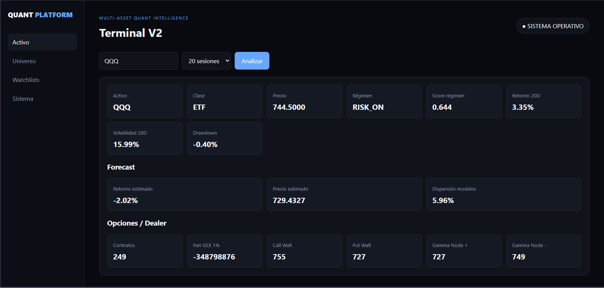
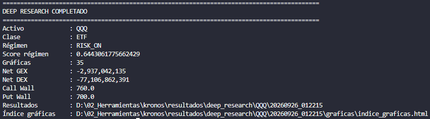
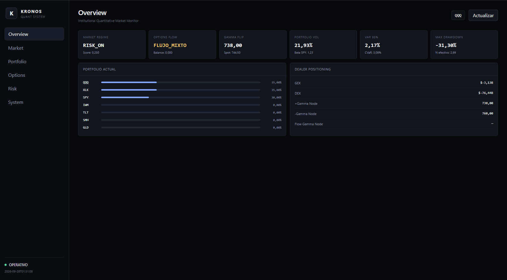

# Quant Platform

Plataforma personal de investigación cuantitativa multi-activo. Kronos es un modelo del Forecast Engine junto con Drift y Momentum. Desarrollo: `quant-platform-v2`; versión histórica: `kronos-quant-v1`.

## Arquitectura

```text
core/activos + core/datos → mercado/régimen + core/modelos/forecast
core/datos → cadena → calidad → Greeks → dealer por vencimiento
mercado/señales → portfolio → riesgo
mercado + forecast + opciones/dealer + escenarios → Deep Research
orquestadores / informes persistidos → API → Dashboard V2
```

Deep Research por ticker todavía no ejecuta portfolio, riesgo ni Options Flow. Estos tienen motores y comandos separados. `model/`, `finetune/`, `examples/` y `webui/` contienen el modelo original y sus herramientas. Los nombres V2/V3/V4 de módulos legacy no representan releases globales.

## Entorno Windows

Raíz: `D:\02_Herramientas\kronos`. Entorno comprobado: Python 3.12.9, PyTorch 2.6.0+cu126 y GTX 1080 Ti. Versiones directas en `requirements.txt`; pruebas en `requirements-dev.txt`. No se ha recreado una instalación limpia.

```powershell
Set-Location D:\02_Herramientas\kronos
$env:TEMP = "$PWD\.cache\tmp"
$env:TMP = $env:TEMP
$env:HF_HOME = "$PWD\.cache\huggingface"
$env:MPLCONFIGDIR = "$PWD\.cache\matplotlib"
New-Item -ItemType Directory -Force $env:TEMP,$env:HF_HOME,$env:MPLCONFIGDIR
# En un entorno ya configurado:
.venv\Scripts\python.exe -m pip install -r requirements-dev.txt --cache-dir .cache\pip
```

Para conservar CUDA, instalar previamente la distribución de PyTorch compatible con el equipo. Requirements fija la versión base, sin escoger una distribución CUDA. Los pesos se descargan desde Hugging Face en el primer uso y deben estar cacheados para las pruebas offline. Entrenamiento y webui tienen requisitos adicionales propios.

## Comandos

```powershell
# V2: http://127.0.0.1:8010
.venv\Scripts\python.exe -m dashboard_v2.servidor
# Investigación con proveedor; requiere conexión
.venv\Scripts\python.exe -m motor_sistema.deep_research QQQ
# Horizonte específico y selección de modelos
.venv\Scripts\python.exe -m motor_sistema.deep_research QQQ 20 --modelos DRIFT MOMENTUM
# Suite offline: regresión Kronos, estabilización y Greeks
.venv\Scripts\python.exe -m herramientas.verificar_proyecto
# Sin pesos de Kronos
.venv\Scripts\python.exe -m herramientas.verificar_proyecto --sin-modelos
# Auditoría histórica sin red ni modificación de originales
.venv\Scripts\python.exe -m herramientas.reprocesar_deep_research --fecha 20260930
# V1: http://127.0.0.1:8000
.venv\Scripts\python.exe -m motor_sistema.release_v1 --dashboard
```

Sin horizonte, Deep Research usa 5/20/60 sesiones; con horizonte, solo el solicitado (1..512). Estados y códigos de salida: OK=0, PARCIAL=2, ERROR=1. Los fallos por etapa y contratos descartados permanecen visibles.

## Resultados y límites

Cada ejecución crea `resultados/deep_research/<TICKER>/<TIMESTAMP>/`, con informe JSON, CSV, calidad/rechazos, perfiles Gamma y gráficas HTML. El dashboard puede leer el último informe persistido. Auditorías offline: `resultados/auditoria_v21/`, conservando spot y DTE históricos. Resultados, datos y cachés no se versionan.

Dealer: proxy calls short/puts long, multiplicador 100, r=4%, q=1%; Walls por OI agregado por strike. Gamma Flip se busca en una malla de ±20% del spot, conservando todos los cruces detectados; ninguno detectado no implica inexistencia fuera/entre puntos. Black-Scholes europeo aproxima opciones que pueden ser americanas. Se excluye 0DTE sin hora fiable. La frescura de bid/ask no está verificada. Flow utiliza comparaciones aproximadas; no observa operaciones ni posiciones reales. Los forecasts requieren validación económica independiente.

## Documentación y vistas

- [Estado contrastado](ESTADO_PROYECTO.md)
- [Prioridades](ROADMAP.md)
- [Cambios y validación](documentacion/CAMBIOS_V21.md)
- [Instrucciones](AGENTS.md)
- [Arquitectura histórica V1](documentacion/ARQUITECTURA_V1.md)




